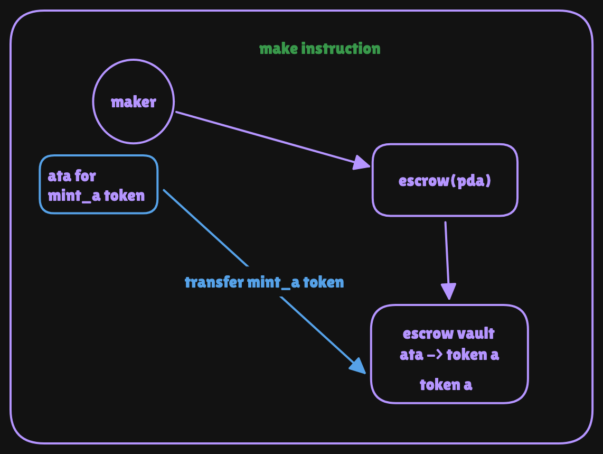
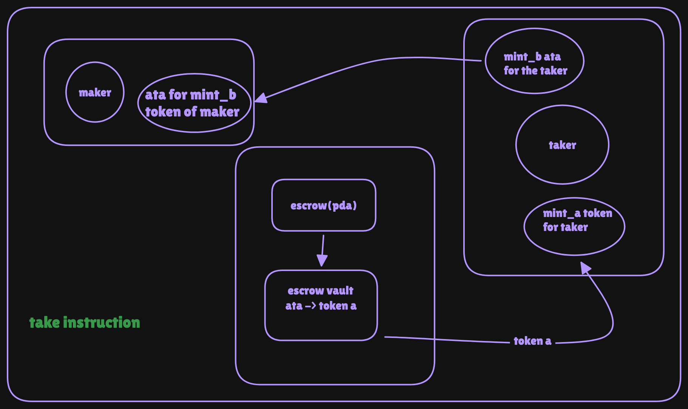
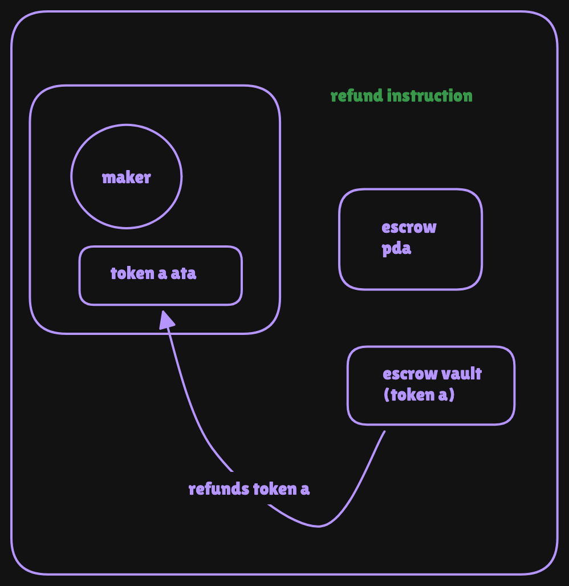
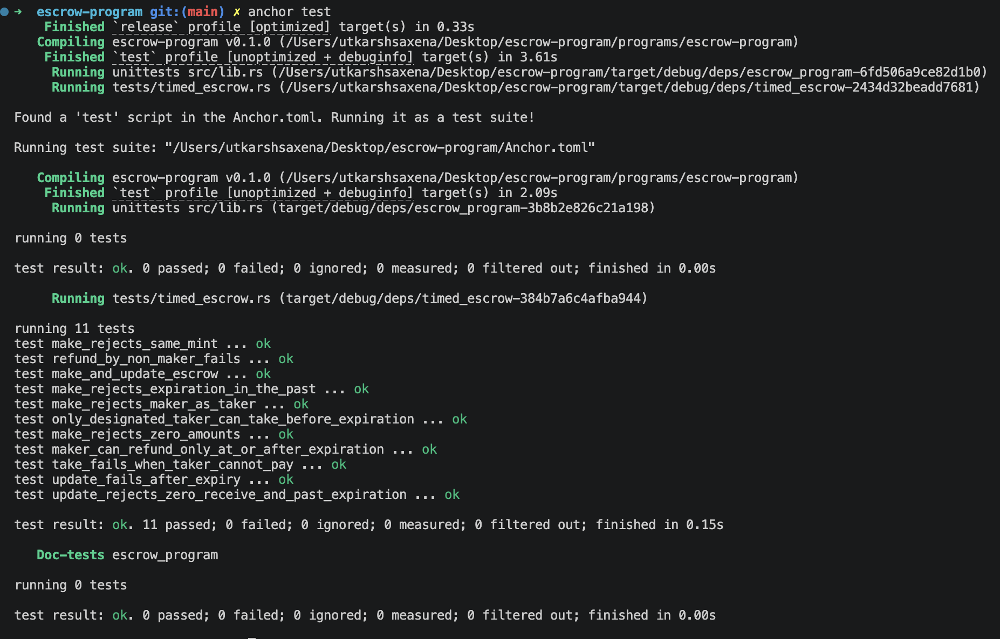

# Timed Escrow Program

A token-for-token escrow on Solana, written with Anchor. A maker locks token A in a program-controlled vault and states how much of token B they want. A **designated taker** can complete the swap atomically **before a deadline**. If nobody takes it, the maker can refund **after the deadline**.

**Program ID:** `BfJ9RytuctpknaRHwCbMQXwZ8WtMRdasPJSzHkKzzu7U`

| | |
|---|---|
| Framework | Anchor 1.x (`anchor-lang 1.1.2`, `anchor-spl 1.2.2`) |
| Tests | Rust + [LiteSVM](https://github.com/LiteSVM/litesvm) |
| Rust toolchain | 1.89.0 (pinned in `rust-toolchain.toml`) |
| Tokens | Any two SPL tokens on the same token program (classic Token or Token-2022, without the transfer-fee extension) |

**Timed mechanism and condition (extension challenge):**
- **Condition (signature):** only the `taker` stored at `make` can sign `take`.
- **Time (Clock sysvar):** `take` and `update` only work **before** `expiration`, and `refund` only works **at or after** it. The program reads the current time with `Clock::get()?.unix_timestamp`.

---

## Table of contents

1. [Architecture](#architecture)
2. [State](#state)
3. [Accounts and PDAs](#accounts-and-pdas)
4. [Instructions](#instructions)
5. [Time rules at a glance](#time-rules-at-a-glance)
6. [Errors](#errors)
7. [Security notes and limitations](#security-notes-and-limitations)
8. [Tests](#tests)
9. [Build and run](#build-and-run)
10. [Project structure](#project-structure)

---

## Architecture

The escrow program owns an **Escrow PDA** that stores the terms. A separate **vault** token account holds the deposited token A, and its authority is the Escrow PDA. Tokens move through the SPL Token program, and the Escrow PDA signs vault transfers with its seeds and bump.

### `make`



<!-- TODO: add the make diagram at docs/images/escrow-make.png -->

The maker's token A account sends the deposit straight to the vault. The program also creates the Escrow PDA, which holds the terms and is the vault's authority.

### `take`



<!-- TODO: add the take diagram at docs/images/escrow-take.png -->

The taker pays token B to the maker, and the vault releases token A to the taker. Then the vault and the Escrow PDA are closed, and their rent goes to the maker.

### `refund`



<!-- TODO: add the refund diagram at docs/images/escrow-refund.png -->

After expiry, the vault returns token A to the maker. Then the vault and the Escrow PDA are closed. Token B is not involved.

> `update` changes terms stored in the Escrow PDA and moves no tokens, so it has no diagram.

---

## State

```rust
#[account]
#[derive(InitSpace)]
pub struct Escrow {
    pub seed: u64,        // lets one maker run many escrows
    pub maker: Pubkey,    // creator; the only one who can refund or update
    pub taker: Pubkey,    // the only account allowed to take
    pub mint_a: Pubkey,   // token the maker deposits
    pub mint_b: Pubkey,   // token the maker wants
    pub deposit: u64,     // amount of A locked at make (record only)
    pub receive: u64,     // amount of B the taker must pay
    pub bump: u8,         // saved PDA bump
    pub expiration: i64,  // unix timestamp of the deadline
}
```

`deposit` is a record only. `take` and `refund` pay out the vault's real balance (`vault.amount`) instead of this field.

---

## Accounts and PDAs

| Account | Derivation | Owner | Purpose |
|---|---|---|---|
| `escrow` | PDA, seeds `["escrow", maker, seed]` | Escrow program | Stores the `Escrow` terms |
| `vault` | Associated token account for `mint_a`, authority = `escrow` | Token program | Holds the maker's token A |
| `maker_ata_a`, `maker_ata_b` | Maker's ATAs | Token program | Maker's token accounts |
| `taker_ata_a`, `taker_ata_b` | Taker's ATAs | Token program | Taker's token accounts |

Because the vault's authority is the Escrow PDA, only the program can move its tokens, by signing with `["escrow", maker, seed, bump]`.

---

## Instructions

`make` uses a custom 1-byte instruction discriminator (`0`). The other instructions use Anchor's default.

### `make(seed, deposit, receive, expiration)`

The maker opens an escrow.

- **Signer:** `maker`.
- **Accounts:** `maker`, `taker` (stored, not a signer), `mint_a`, `mint_b`, `maker_ata_a`, `escrow` (init), `vault` (init), `associated_token_program`, `token_program`, `system_program`.
- **Checks:**
  - `maker != taker`
  - `mint_a != mint_b`
  - `deposit > 0` and `receive > 0`
  - `expiration > now`
- **Effects:** saves the terms in `escrow`, then `transfer_checked` of `deposit` token A from `maker_ata_a` to `vault`.

### `take()`

The designated taker completes the swap.

- **Signer:** `taker`. It must equal `escrow.taker`.
- **Accounts:** `maker`, `taker`, `escrow` (mut, closes to maker), `mint_a`, `mint_b`, `vault`, `taker_ata_a`, `taker_ata_b`, `maker_ata_b`, `token_program`.
- **Checks:**
  - `now < expiration`
  - `has_one` on `maker`, `taker`, `mint_a`, `mint_b`, plus the seeds and saved bump
- **Effects, in order:**
  1. `transfer_checked`: `escrow.receive` of token B from `taker_ata_b` to `maker_ata_b` (taker signs).
  2. `transfer_checked`: the full vault balance of token A from `vault` to `taker_ata_a` (Escrow PDA signs).
  3. `close_account`: closes the vault, rent to the maker (Escrow PDA signs).
  4. The `close = maker` constraint closes `escrow` and returns its rent to the maker.
- The three steps run in one transaction, so either all of them succeed or none do.

### `refund()`

The maker cancels after expiry.

- **Signer:** `maker`. It must equal `escrow.maker`.
- **Accounts:** `maker`, `escrow` (mut, closes to maker), `mint_a`, `vault`, `maker_ata_a`, `token_program`.
- **Checks:** `now >= expiration`, plus `has_one` on `maker` and `mint_a`.
- **Effects:**
  1. `transfer_checked`: the full vault balance of token A from `vault` to `maker_ata_a` (Escrow PDA signs).
  2. `close_account`: closes the vault, rent to the maker.
  3. `close = maker` closes `escrow`.

### `update(seed, receive, expiration)`

The maker changes the terms while the escrow is live.

- **Signer:** `maker`.
- **Accounts:** `maker`, `escrow` (mut).
- **Checks:**
  - `escrow.seed == seed`
  - `now < escrow.expiration`, so an expired escrow can't be updated
  - the new `expiration > now`
  - the new `receive > 0`
- **Effects:** overwrites `escrow.receive` and `escrow.expiration`. No tokens move.
- **Can't change:** `deposit`, `mint_a`, `mint_b`, `taker`, `seed`.

---

## Time rules at a glance

| When | `update` | `take` | `refund` |
|---|---|---|---|
| Before `expiration` | allowed | allowed (taker only) | rejected |
| At or after `expiration` | rejected | rejected | allowed (maker only) |
| After `take` or `refund` | rejected | rejected | rejected (accounts are closed) |

---

## Errors

| Error | Raised when |
|---|---|
| `InvalidSeed` | `update` gets a `seed` that doesn't match the escrow |
| `InvalidExpiration` | `make` or `update` gets an `expiration` that is not in the future |
| `InvalidAmount` | `deposit` or `receive` is zero |
| `MakerCannotBeTaker` | `make` with `maker == taker` |
| `EscrowExpired` | `take` or `update` at or after `expiration` |
| `EscrowNotExpired` | `refund` before `expiration` |
| `SameMint` | `make` with `mint_a == mint_b` |

Wrong signers and wrong accounts are rejected by Anchor's constraints (`address`, `has_one`, seeds), not by custom errors.

---

## Security notes and limitations

- **Atomic swap.** `take` runs both transfers and the closes in one transaction. A failure anywhere reverts everything.
- **Designated taker.** `escrow.taker` is stored at `make` and enforced with `address = escrow.taker` and `has_one = taker`.
- **No signing key for the vault.** Its authority is a PDA, so only this program can move funds.
- **Account validation.** Mints, maker, taker and the vault are checked against the stored escrow with `has_one`, ATA constraints and the PDA seeds.
- **Update can change `receive`.** The maker could raise `receive` just before the taker's `take` lands. A possible fix is a `max_receive` argument on `take`.
- **Existing token accounts required.** `take` needs `taker_ata_a` and `maker_ata_b` to exist already, because it does not create them.
- **Refund needs the maker's token A account.** `refund` fails if the maker closed `maker_ata_a` after `make`, until they recreate it.
- **One token program.** Both mints must belong to the same token program. A classic-Token vs Token-2022 swap isn't supported.
- **Transfer-fee mints are not supported.** Token-2022 mints with the transfer-fee extension keep fees withheld in the vault, which blocks closing it until they are harvested. Use mints without that extension.

---

## Tests

Tests are written in Rust with LiteSVM. They load the compiled program (`target/deploy/escrow_program.so`) into an in-process SVM, and move the clock with the Clock sysvar to test the time rules. No local validator is needed.

| Test | What it checks |
|---|---|
| `make_and_update_escrow` | `make` locks token A and saves the terms, `update` by the maker changes them, and an update by a non-maker is rejected |
| `only_designated_taker_can_take_before_expiration` | A non-taker can't take, the taker can, balances are correct, and the escrow and vault are closed |
| `maker_can_refund_only_at_or_after_expiration` | Refund fails before expiry and for a non-maker, then succeeds at expiry and closes the accounts |
| `make_rejects_same_mint` | `mint_a == mint_b` is rejected and no escrow is created |
| `make_rejects_expiration_in_the_past` | Past and present timestamps are rejected |
| `make_rejects_zero_amounts` | Zero `deposit` and zero `receive` are rejected |
| `make_rejects_maker_as_taker` | `maker == taker` is rejected |
| `update_fails_after_expiry` | `update` at expiry is rejected and the terms are unchanged |
| `update_rejects_zero_receive_and_past_expiration` | Invalid new values are rejected and the terms are unchanged |
| `refund_by_non_maker_fails` | A non-maker can't refund even after expiry, and the vault is untouched |
| `take_fails_when_taker_cannot_pay` | An under-funded taker fails and the vault, escrow and balances are unchanged |

### Test output



<!-- TODO: add a screenshot of `cargo test` passing at docs/images/escrow-tests.png -->

---

## Build and run

```bash
# build the program (produces target/deploy/escrow_program.so)
anchor build

# run the LiteSVM tests (the build above must come first)
cargo test
```

Requirements: Rust 1.89.0 (installed automatically by `rust-toolchain.toml`), the Solana CLI, and Anchor 1.x.

---

## Project structure

```
programs/escrow-program/
├── src/
│   ├── lib.rs               # program entrypoints
│   ├── constants.rs         # ESCROW_SEED
│   ├── error.rs             # EscrowError
│   ├── state.rs             # Escrow account
│   └── instructions/
│       ├── make.rs
│       ├── take.rs
│       ├── refund.rs
│       └── update.rs
└── tests/
    └── timed_escrow.rs      # LiteSVM tests
```
